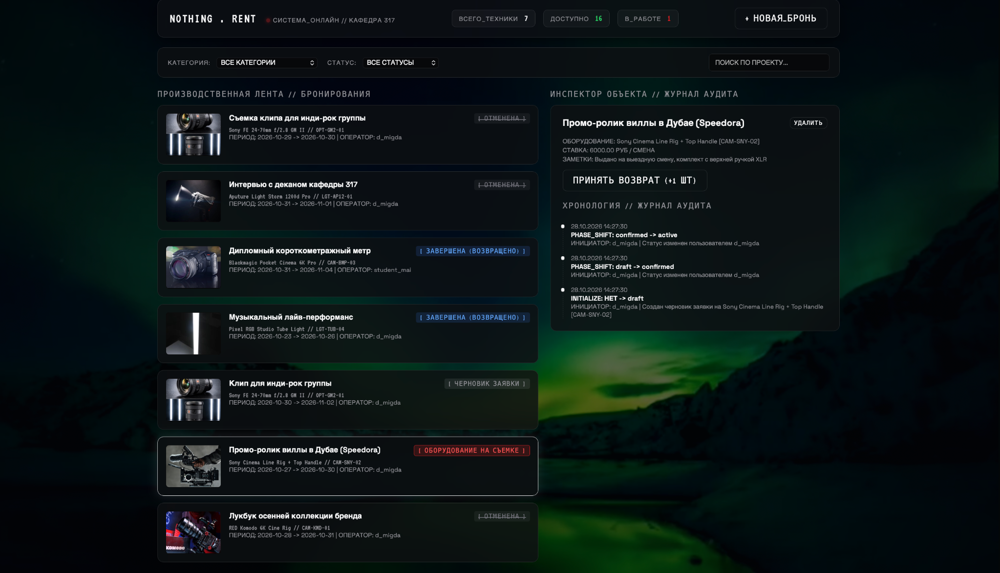

# NOTHING.RENT

Веб-приложение для учёта и бронирования съёмочного оборудования кафедры 317 МАИ

Студенты могут бронировать технику и отслеживать свои заявки, администратор — управлять общим реестром. Система контролирует доступность оборудования, допустимые изменения статусов и сохраняет историю операций.



## Стек

Python 3.14, Django 6.1.2, Django REST Framework, HTML, CSS, JavaScript, SQLite, PostgreSQL, Gunicorn, WhiteNoise, OpenAPI.

## Локальный запуск

Потребуются Python 3.14, Git, Make, Bash и curl.

```bash
git clone https://github.com/migdadanil/srs7_3sem.git
cd srs7_3sem
make install
make migrate
make seed
```

Команда `make install` создаёт виртуальное окружение, устанавливает зависимости и подготавливает файл `.env`.

В чистой базе создаются 8 позиций оборудования, 6 бронирований и 13 событий аудита.

Назначение паролей демонстрационным пользователям:

```bash
venv/bin/python manage.py changepassword demo_admin
venv/bin/python manage.py changepassword demo_student
```

Запуск приложения:

```bash
make run
```

- http://127.0.0.1:8000/ — приложение
- `/admin/` — панель администратора
- `/api/docs/` — Swagger
- `/api/redoc/` — ReDoc
- `/api/schema/` — OpenAPI

## Конфигурация

Настройки приложения вынесены в файл `.env`, чтобы один и тот же проект можно было запускать локально и в облаке без изменения исходного кода. Пример конфигурации находится в [.env.example](.env.example).

| Переменная | Локальное значение | Назначение |
|---|---|---|
| `DJANGO_SECRET_KEY` | `local-development-only` | Защита подписанных данных и сессий |
| `DJANGO_DEBUG` | `True` | Отображение подробной информации об ошибках |
| `DJANGO_ALLOWED_HOSTS` | `localhost,127.0.0.1` | Разрешённые хосты приложения |
| `DJANGO_CSRF_TRUSTED_ORIGINS` | `http://localhost:8000,http://127.0.0.1:8000` | Доверенные источники запросов |
| `DATABASE_URL` | Пустое значение | Подключение к БД (по умолчанию SQLite) |

При облачном запуске используется отдельный секретный ключ, отключается режим отладки и настраивается подключение к PostgreSQL. Файл `.env` исключён из Git.

Подробная настройка облачного окружения описана в [руководстве по развёртыванию](docs/deployment.md).

## Проверка

```bash
make check
make test-clean
```

Чистый запуск проверен на macOS с Python 3.14.5. Зависимости установлены, миграции применены, демонстрационные данные созданы. Все четыре проверяемых HTTP-ресурса вернули код 200.

Для ручной проверки необходимо создать бронирование, проверить GET и POST-запросы во вкладке Network, перезапустить сервер и убедиться в сохранности записи.

## Документация

Основной код приложения находится в каталоге `rentals`, настройки Django — в `config`. Техническая документация разделена по направлениям:

- [Архитектура](docs/architecture.md) — устройство приложения и взаимодействие его компонентов.
- [База данных](docs/database.md) — модели, их поля, связи и ограничения.
- [REST API](docs/api.md) — доступные маршруты, примеры запросов и ответов сервера.
- [Развёртывание](docs/deployment.md) — настройка окружения, локальный запуск и размещение на Render.
- [Диагностика](docs/troubleshooting.md) — распространённые ошибки, их причины и способы устранения.

## Авторы
Cтуденты кафедры 317:

Данил Мигда — М3О-237БВ-25  
Азалия Медведева — М3О-234БВ-25
