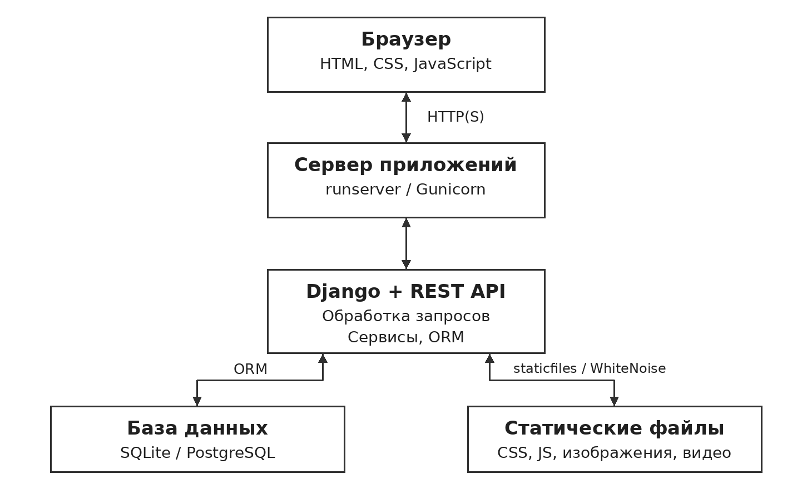

# Архитектура приложения

Интерфейс и серверная часть находятся в одном Django-проекте. При открытии сайта Django возвращает HTML-страницу, а JavaScript отправляет запросы к REST API и обновляет данные на экране



Запросы к API обрабатываются в `views.py`, а сериализаторы проверяют входные данные и формируют JSON-ответы. Создание бронирования и смена его статуса выполняются через `BookingWorkflowService`. Для работы с базой используется Django ORM. Статические файлы локально обслуживает Django, для облачного запуска настроен WhiteNoise.

API требует авторизации: студент видит свои бронирования, сотрудник (`is_staff`) — все. Локально приложение запускается через `runserver` и использует SQLite. Для облака настроено подключение PostgreSQL и предусмотрен запуск через Gunicorn; облачная проверка ещё не проведена.

## Структура проекта

```text
config/                        настройки и общие маршруты Django
rentals/                       основное приложение
  models.py                    модели базы данных
  views.py, urls.py             обработка запросов и маршруты
  serializers.py               проверка данных и JSON-ответы
  services.py                  логика бронирований
  admin.py                     административная панель
  templates/, static/          HTML, CSS, JS и медиафайлы
  migrations/                  изменения структуры БД
  management/commands/         загрузка демонстрационных данных
  tests.py                     файл тестов
docs/                         документация
.github/workflows/              автоматические проверки
.env.example                   шаблон настроек
requirements.txt               зависимости
manage.py, Makefile             команды разработчика
verify_reproducibility.sh       проверка чистого запуска
```

[К описанию проекта](../README.md) · [База данных](database.md) · [REST API](api.md)
