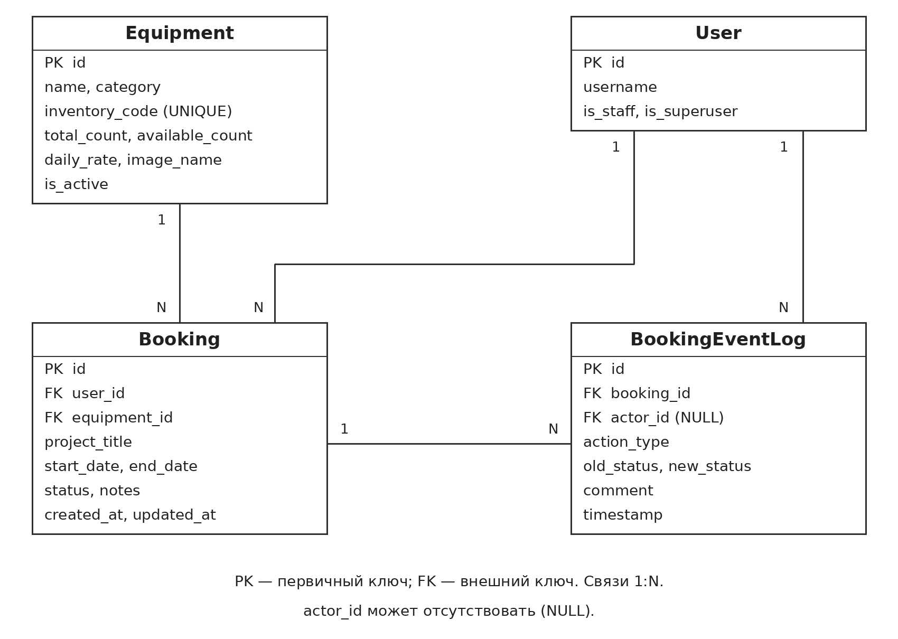

# База данных

Локально проект использует SQLite. Структура данных описана в `rentals/models.py`, модель пользователя предоставляется Django (`auth.User`). Для облачного запуска предусмотрено подключение PostgreSQL

**Equipment** — каталог оборудования. У каждой позиции есть уникальный инвентарный код, общее и доступное количество техники, стоимость смены и имя файла изображения.

**Booking** — бронирование, связанное с пользователем и оборудованием. Хранит название проекта, период аренды, статус и заметки.

**BookingEventLog** — история создания бронирования и изменения его статуса. В записи сохраняются инициатор, старый и новый статусы, комментарий и время события.

**User** — стандартная модель пользователя Django. Признак `is_staff` используется для разграничения доступа к бронированиям.

## Связи и ограничения

Один пользователь может создать несколько бронирований, а одна позиция оборудования может участвовать в нескольких бронированиях. У каждой брони может быть несколько событий аудита. Удалить оборудование, на которое существуют бронирования, нельзя (`PROTECT`). При удалении бронирования связанные события удаляются (`CASCADE`). При удалении инициатора события поле `actor` становится пустым (`SET_NULL`), если само событие не удаляется каскадно. При удалении владельца его бронирования удаляются (`CASCADE`).

При подтверждении брони сервис проверяет доступный остаток и уменьшает его на единицу; при возврате или допустимой отмене зарезервированная единица возвращается на склад. Статусы: `draft`, `confirmed`, `active`, `returned`, `cancelled`.

[К описанию проекта](../README.md) · [Архитектура](architecture.md)
